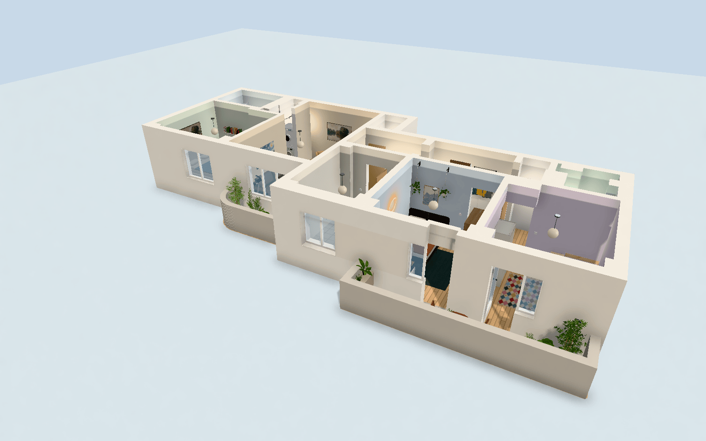
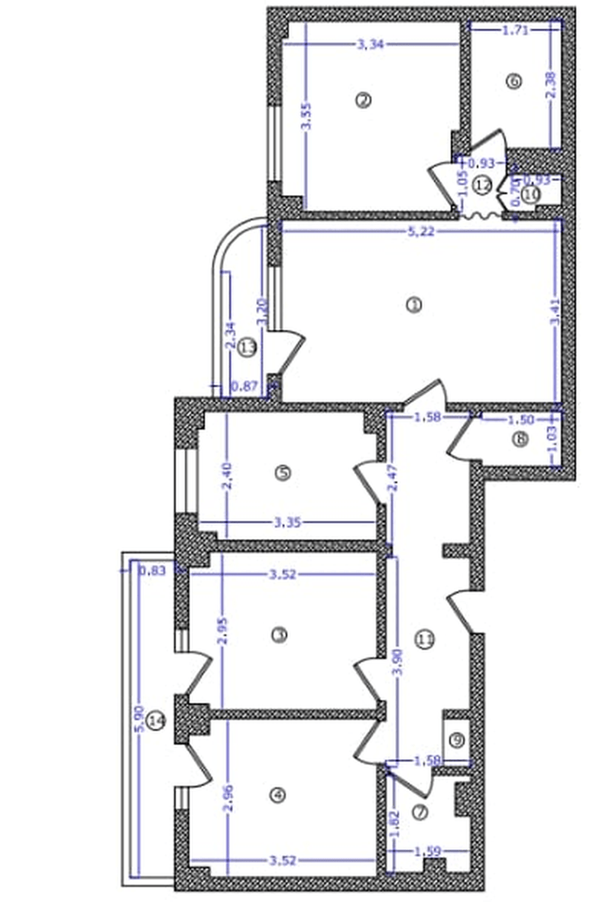
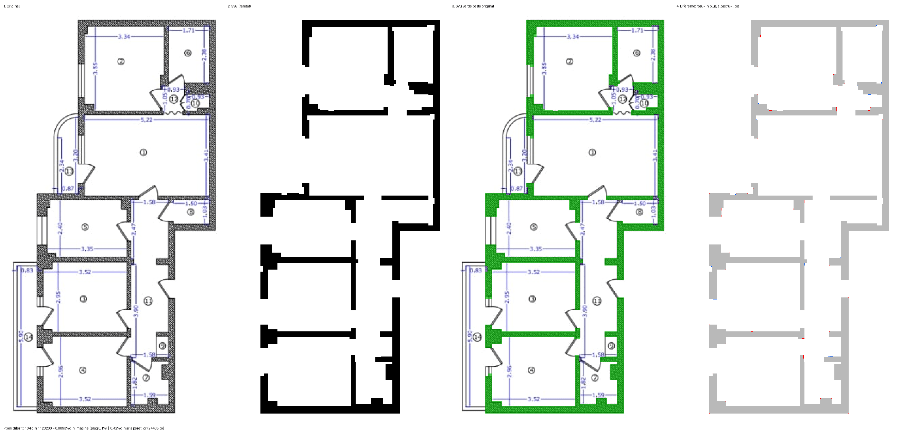
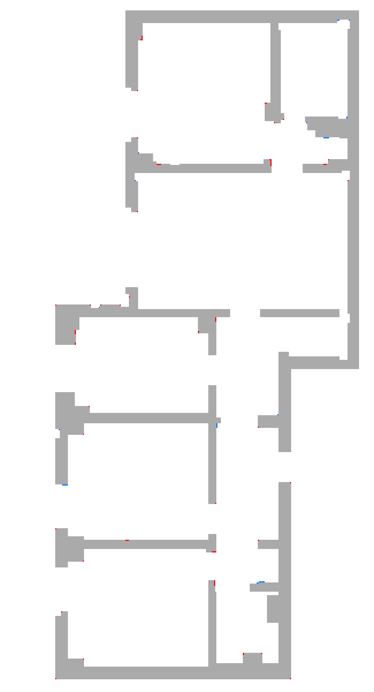
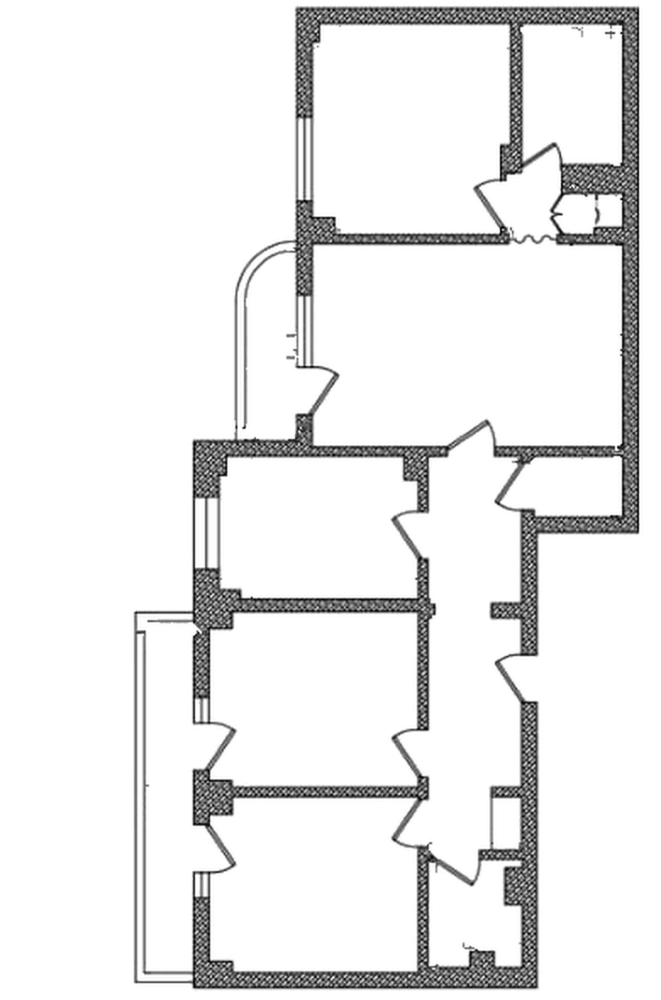
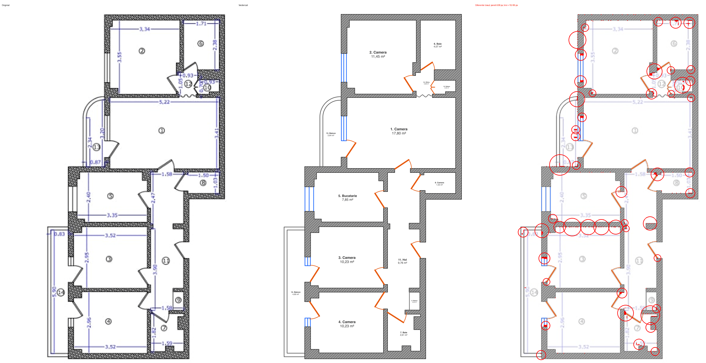
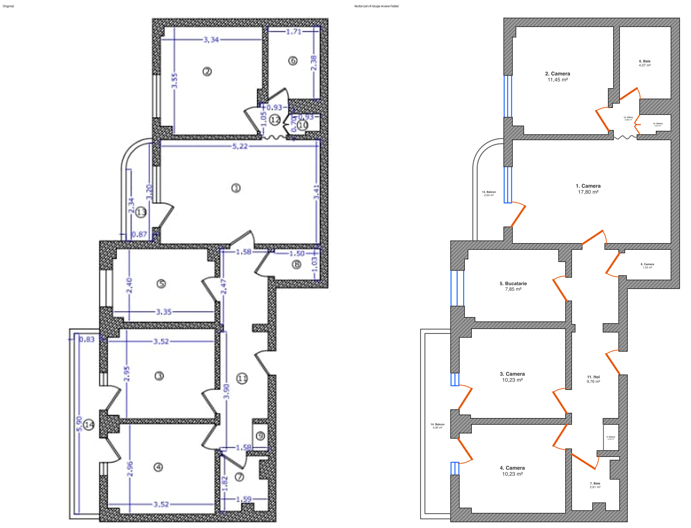

# Apartament 3D

Un apartament de 85 m², reconstruit dintr-un releveu: plan 2D vectorial și o vizită 3D mobilată, direct în browser.

**Deschide:** https://victorrentea.github.io/apartament-3d/

- mută: drag · rotește: ⌘ + drag · zoom: rotiță · „Plimbare (WASD)” pentru mers prin casă, E deschide ușile
- ☀️/🌙 comută zi / noapte · „Produse” listează mobila cu linkuri · Shift pe o piesă arată numele și prețul, Shift + click deschide pagina produsului

## Cum am ajuns aici

Totul a pornit de la o poză făcută cu telefonul releveului cadastral (PDF, scara 1:100) și s-a
făcut într-o seară, cu Claude Code, prin dictare și capturi de ecran adnotate.

### 0. Punctul de plecare: releveul

Un screenshot de telefon, 720 px lățime. Planul ocupă cam 390 × 590 px din el; 34,6 px = 1 m
(media a 13 cote din releveu, între 34,2 și 35,1). Foaia întreagă rămâne locală, pentru că are
adresa și datele cadastrale; aici e doar planul.

### 1. Pereții, pixel-perfect într-un SVG

Prima cerință: un SVG cu pereții identici cu desenul, iterat până la **cel mult 0,1% pixeli
diferiți**. Masca pereților hașurați e scoasă din poză (`mask.py`), conturul ei e trasat în
poligoane ortogonale (`vectorize.py`), iar `compare.py` randează SVG-ul și numără pixelii diferiți.

De la stânga la dreapta: originalul, SVG-ul randat, SVG-ul (verde) peste original, diferențele
(roșu = în plus, albastru = lipsă). Rezultat: **104 pixeli diferiți, 0,0093% din imagine**.

Zoom pe diferențe, de 3 ori:

### 2. Desenul curățat de cote

Ca să vectorizez și ușile, ferestrele și balustradele, nu doar pereții, întâi am scos din desen
cotele albastre și cercurile cu numerele camerelor (`clean.py`). Unde o cotă traversa un perete,
hașura e refăcută din pixelii de perete vecini; unde traversa o linie, linia e continuată. Am
verificat pe zoom-uri (`zoompairs.py`) locurile unde se „mâncase” ceva din desen.

### 3. Planul vectorial

`build_plan.py` produce planul complet: pereți plini și hașurați, ferestre albastre, uși
portocalii cu foaia înclinată și arcul de deschidere, iar fiecare cameră cu numele și suprafața
din tabelul releveului. Ies `plan.svg`, `plan.dxf` (straturi PERETI, FERESTRE, USI…) și
`plan.dwg`, deschis apoi în [CADCraft](https://github.com/storytold/cadcraft).

### 4. Verificarea, pe diferențe încercuite cu roșu

`diff_red.py` compară planul vectorial cu desenul curățat: pereții pixel cu pixel, liniile subțiri
cu toleranță de 1 px. Fiecare zonă care diferă e încercuită cu roșu, ca să poată fi verificată pe
rând. A rămas: pereți 538 px, linii +10 / −85 px.

Încă o verificare, independentă de pixeli: suprafața fiecărei camere măsurată pe planul vectorial
(`room_areas.py`), comparată cu tabelul „Recapitulație” din releveu. Camerele mari ies la ±1,5%;
diferențele mai mari sunt la debarale și balcoane, unde 1–2 px de perete schimbă mult o suprafață
sub 1 m².

### 5. Versiunea finală, după un review adversarial

Un review separat (Claude Fable 5.2) a dat desenului nota A−: pereții, geamurile, ușile și
balustradele stau la cel mult 0,5 px de original. v4 corectează și ce a mai găsit: ușa pliantă a
debaralei 10 și linia ondulată redesenate curat, balamalele ușilor de la camerele 2 și 4 mutate pe
colțul spaletului, spaletul din oficiu îngustat, capete de geam desenate în plus scoase.

### 6. Din plan în 3D

`3d/gen3d.py` citește `plan.dxf` și ridică pereții la 2,70 m într-o singură pagină Three.js, fără
server. Golurile dintre pereți devin uși sau ferestre după cerneala care stă în ele, iar podeaua e
tot ce nu se poate atinge din exterior. Apoi, cameră cu cameră, au venit:

- mobila, cu modele 3D de pe paginile de produs IKEA, cu prețuri și linkuri în lista „Produse”
- uși care se deschid cu E, mers prin casă cu WASD, coliziuni cu pereții și mobila
- lumină de zi și de noapte cu umbre, lustre în camere, aplice în băi și pe hol
- covoare, tablouri, TV, oglinzi care chiar reflectă, masă și plante pe balcoane
- galeria din stânga: poze din colțurile fiecărei camere, făcute headless de `3d/gallery.mjs`

## Ce e aici

- `plan.svg`, `plan.dxf`, `plan.dwg`: planul vectorial (pereți, uși, ferestre, cote), generat de `build_plan.py`
- `3d/gen3d.py` + `3d/template.html` → `3d/apartament3d.html` (Three.js, o singură pagină, fără server)
- `3d/furniture/<cameră>/`: mobila fiecărei camere (`furniture.json` = piese, poziții, produs, preț, link)
- `docs/`: imaginile din „Cum am ajuns aici”

Regenerare: `.venv/bin/python 3d/gen3d.py plan.dxf 3d/apartament3d.html`

Modelele 3D de mobilier provin din paginile de produs IKEA România și rămân proprietatea IKEA; sunt folosite aici doar ca ilustrare, necomercial.
